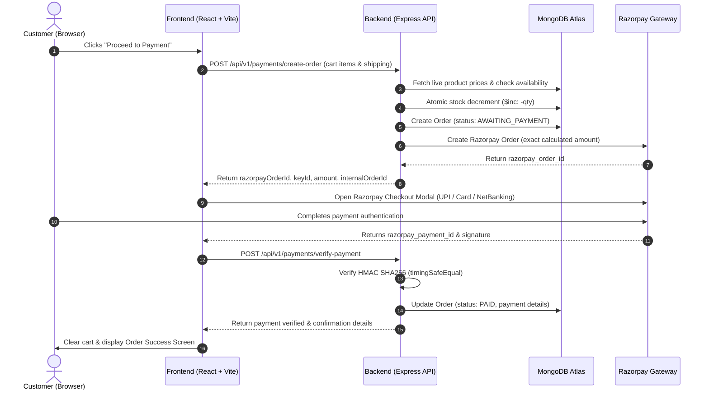

# 🌸 Crojyan (Bloom & Loop) — Handcrafted Crochet Flower Bouquets

> An artisanal full-stack e-commerce platform for handcrafted forever crochet flower bouquets and floral arrangements. Built with **React 18**, **Node.js**, **Express**, **MongoDB**, **Cloudinary**, and **Razorpay**.

[](https://nodejs.org/)
[](https://reactjs.org/)
[](https://vitejs.dev/)
[](https://tailwindcss.com/)
[](https://www.mongodb.com/)
[](https://razorpay.com/)
[](#license)

---

## 📖 Table of Contents

- [Overview](#-overview)
- [Key Features](#-key-features)
  - [Customer Storefront](#-customer-storefront)
  - [Razorpay Payment Integration](#-razorpay-payment-integration)
  - [Admin Dashboard & Operations](#-admin-dashboard--operations)
  - [Security & Production Hardening](#-security--production-hardening)
- [Payment & Checkout Architecture](#-payment--checkout-architecture)
- [Tech Stack](#-tech-stack)
- [Project Structure](#-project-structure)
- [Environment Configuration](#-environment-configuration)
- [Quick Start Guide](#-quick-start-guide)
  - [Prerequisites](#1-prerequisites)
  - [Backend Setup](#2-backend-setup)
  - [Database Seeding](#3-database-seeding)
  - [Frontend Setup](#4-frontend-setup)
- [API Endpoints Reference](#-api-endpoints-reference)
- [Available Scripts](#-available-scripts)
- [License](#-license)

---

## 🌟 Overview

**Crojyan (Bloom & Loop)** is a modern e-commerce application crafted specifically for showcasing and purchasing everlasting crochet flower bouquets. It provides customers with an interactive, delightful shopping experience featuring high-definition photo galleries, customizable ribbon notes, seamless Razorpay payments, and an active Instagram social-proof showcase. For store owners, it includes a password-protected admin portal with multi-image catalog management, real-time stock tracking, and complete order lifecycle administration.

---

## 🚀 Key Features

### 🛍️ Customer Storefront
- **Dynamic Hero & Collections Showcase**: High-resolution imagery highlighting handcrafted flower arrangements with immediate call-to-actions.
- **Product Catalog & Real-Time Filtering**: Browse bouquets by category, filter by price ranges, and sort by stock status and price.
- **Multi-Photo Interactive Gallery & Lightbox**: Product detail view with multi-image thumbnail carousel and full-screen image lightbox modal.
- **Bouquet Customization**: Tailor gift orders with customized ribbon colors, wrapping paper shades, and heartfelt personalized greeting card messages.
- **Slide-Over Persistent Cart Drawer**: Fast client-side cart powered by React Context API with automatic `localStorage` synchronization.
- **Social Proof & Community Showcase**: Dedicated Instagram gallery (@crojyan), customer review stats, and artisanal trust highlights (100% Handcrafted, Eco-friendly yarn, Everlasting blooms).
- **Responsive & Accessible Design**: Crafted using Tailwind CSS with mobile-first typography and smooth micro-interactions.

### 💳 Razorpay Payment Integration
- **Server-Side Price Validation**: Order prices are recalculated server-side using current MongoDB prices, preventing client-side price tampering.
- **Atomic Stock Reservation**: Atomically decrements product inventory (`$inc: { stockCount: -qty }`) during checkout initiation, preventing overselling race conditions.
- **Razorpay Standard Checkout SDK**: Native modal checkout supporting UPI, Credit/Debit cards, Net Banking, and Digital Wallets.
- **Cryptographic Signature Verification**: Verifies payment authentication with HMAC SHA256 using timing-safe buffer comparisons (`crypto.timingSafeEqual`) to prevent timing attacks.
- **Asynchronous Webhooks**: Handles `/api/v1/payments/webhook` mounted with raw body parsing for asynchronous payment confirmation (`order.paid`, `payment.failed`).
- **Automated Stock Release Job**: Background cron job (`orderExpiryJob.js`) that runs periodically to release held inventory for abandoned or expired checkout sessions.

### 🔐 Admin Dashboard & Operations
- **Protected Admin Portal**: Dedicated JWT-based login (`/admin/login`) with strict route guards (`AdminProtectedRoute`).
- **Storefront Admin Profile Indicator**: Displays a quick-access admin status badge in the storefront navbar when authenticated.
- **Product Management (CRUD)**: Create, update, toggle availability, and delete bouquet products.
- **Multi-Image Upload Manager**: Upload up to 8 images per product with drag-and-drop support and primary photo selection.
- **Dual Media Storage Engine**: Cloud storage using **Cloudinary** with automated fallback to local disk storage (`/uploads`).
- **Order Lifecycle Administration**: View and filter orders across standard statuses (`AWAITING_PAYMENT`, `PAID`, `PROCESSING`, `SHIPPED`, `DELIVERED`, `CANCELLED`) with strict state-transition validations.

### 🛡️ Security & Production Hardening
- **Password Security**: Strong bcrypt password hashing (cost factor 12).
- **Rate Limiting**: Protects sensitive endpoints with `express-rate-limit` (login attempts and checkout creation).
- **Data Sanitization**: Prevents MongoDB Operator Injection attacks using `express-mongo-sanitize`.
- **HTTP Security**: Configured with `helmet` for secure HTTP headers.
- **Input Validation**: Strict request payload schema validation using `Zod`.
- **Structured Logging**: Request logs via Morgan piped to Winston with sanitization to ensure zero password or secret leakage.

---

## 🔄 Payment & Checkout Architecture



---

## 🛠️ Tech Stack

| Layer | Technologies |
| :--- | :--- |
| **Frontend** | React 18, Vite 5, React Router v6, Tailwind CSS 3, Lucide React, Context API |
| **Backend** | Node.js (v18+), Express.js 4, Mongoose 8, MongoDB Atlas |
| **Payments** | Razorpay Node.js SDK (`razorpay`), Razorpay Checkout JS SDK |
| **Media & Storage** | Cloudinary v2, `multer-storage-cloudinary`, Multer |
| **Security & Auth** | JSON Web Tokens (`jsonwebtoken`), `bcryptjs`, `helmet`, `express-mongo-sanitize` |
| **Validation & Utils**| Zod, Winston Logger, Morgan Logger, `express-rate-limit` |

---

## 📁 Project Structure

```text
crojyan_client_akanshi/
├── explore/                               # Architecture docs, audits & reference media
│   ├── our_craft_images/                  # Product photography & Instagram source assets
│   ├── security_and_correctness_audit_report.md
│   └── Component-Level Architecture rozarpay-crojyan.txt
│
└── repo/
    ├── backend/
    │   ├── src/
    │   │   ├── config/                    # DB, Cloudinary, Razorpay, Logger & Env configs
    │   │   ├── constants/                 # Error codes, order & payment status enums
    │   │   ├── controllers/               # Auth, Product, Order, Payment controllers
    │   │   ├── middleware/                # Auth guards, Rate limiters, Uploads, Error handlers
    │   │   ├── models/                    # Mongoose schemas (Admin, Product, Order)
    │   │   ├── routes/                    # Express route modules (auth, products, orders, payments)
    │   │   ├── scripts/                   # Database seeder (seed.js)
    │   │   ├── services/                  # Business logic (orderService, paymentService, etc.)
    │   │   ├── utils/                     # AppError, Crypto timing-safe utils, Async handler
    │   │   ├── validators/                # Zod schemas (auth, product, order, payment)
    │   │   ├── app.js                     # Express app setup & middleware pipeline
    │   │   └── server.js                  # HTTP server entry point & order expiry cron job
    │   ├── uploads/                       # Local media storage fallback folder
    │   ├── .env.example                   # Environment configuration template
    │   └── package.json
    │
    └── frontend/
        ├── src/
        │   ├── assets/                    # Brand logos, hero bouquets & Instagram photos
        │   ├── components/                # Navbar, Hero, ProductGallery, SocialProof, CartDrawer
        │   ├── context/                   # AuthContext, CartContext
        │   ├── pages/                     # HomePage, ShopPage, ProductDetailPage, CheckoutPage, AdminDashboard
        │   ├── services/                  # API client (`api.js`) & Razorpay payment service
        │   ├── App.jsx                    # Routing configuration & layout wrappers
        │   └── main.jsx                   # React entry point
        ├── index.html
        ├── vite.config.js                 # Vite dev server with `/api` and `/uploads` proxy
        └── package.json
```

---

## ⚙️ Environment Configuration

### Backend Configuration
Create a `.env` file in the `repo/backend/` directory based on `repo/backend/.env.example`:

```env
# Server Configuration
PORT=5000
NODE_ENV=development
CLIENT_URL=http://localhost:5173

# Database & Authentication
MONGO_URI=mongodb+srv://<username>:<password>@cluster0.xxxxx.mongodb.net/crojyan_db?retryWrites=true&w=majority
JWT_SECRET=your_minimum_32_character_jwt_secret_key_here
JWT_EXPIRES_IN=7d

# Initial Admin Seeding Credentials (Used when running npm run seed)
ADMIN_INITIAL_EMAIL=admin@crojyan.com
ADMIN_INITIAL_PASSWORD=YourSecureAdminPassword123!

# Cloudinary Cloud Media Storage (Optional: defaults to local /uploads if omitted)
CLOUDINARY_CLOUD_NAME=your_cloudinary_cloud_name
CLOUDINARY_API_KEY=your_cloudinary_api_key
CLOUDINARY_API_SECRET=your_cloudinary_api_secret

# Razorpay Payment Gateway Credentials
RAZORPAY_KEY_ID=rzp_test_your_key_id
RAZORPAY_KEY_SECRET=your_razorpay_key_secret
RAZORPAY_WEBHOOK_SECRET=your_razorpay_webhook_secret
```

---

## ⚡ Quick Start Guide

### 1. Prerequisites
- **Node.js**: `v18.x` or higher
- **npm**: `v9.x` or higher
- **MongoDB**: Local MongoDB instance or free [MongoDB Atlas](https://www.mongodb.com/cloud/atlas) cluster
- **Razorpay Account**: Free [Razorpay Dashboard](https://dashboard.razorpay.com/) test mode credentials

---

### 2. Backend Setup

```bash
# Navigate to the backend directory
cd repo/backend

# Install dependencies
npm install

# Configure environment variables
cp .env.example .env
# Edit .env with your MongoDB URI, JWT secret, and Razorpay keys
```

---

### 3. Database Seeding

Initialize the database with the default admin account and sample bouquet catalog:

```bash
# Run the seeding script inside repo/backend
npm run seed
```

> **Default Admin Account:**
> - **Email:** Value configured in `ADMIN_INITIAL_EMAIL` (default: `admin@crojyan.com`)
> - **Password:** Value configured in `ADMIN_INITIAL_PASSWORD`

---

### 4. Running Backend Server

```bash
# Development mode with automatic reload
npm run dev

# Production start
npm start
```

The backend server will run on **`http://localhost:5000`**.

---

### 5. Frontend Setup

```bash
# Open a new terminal and navigate to the frontend directory
cd repo/frontend

# Install dependencies
npm install

# Start the Vite development server
npm run dev
```

The frontend application will run on **`http://localhost:5173`**.

---

## 📡 API Endpoints Reference

### 🔐 Authentication (`/api/v1/auth`)
| Method | Endpoint | Description | Rate Limit | Access |
| :--- | :--- | :--- | :--- | :--- |
| `POST` | `/api/v1/auth/login` | Admin authentication & JWT token generation | 5 req / 15m | Public |
| `GET` | `/api/v1/auth/me` | Fetch currently authenticated admin profile | None | Admin |

### 💐 Products (`/api/v1/products`)
| Method | Endpoint | Description | Access |
| :--- | :--- | :--- | :--- |
| `GET` | `/api/v1/products` | Retrieve bouquet catalog with search, filter & pagination | Public |
| `GET` | `/api/v1/products/:id` | Retrieve single bouquet product details | Public |
| `POST` | `/api/v1/products` | Create a new bouquet (supports up to 8 uploaded images) | Admin |
| `PUT` | `/api/v1/products/:id` | Update bouquet product data, inventory & photos | Admin |
| `DELETE` | `/api/v1/products/:id` | Delete product and remove media assets | Admin |

### 💳 Payments (`/api/v1/payments`)
| Method | Endpoint | Description | Rate Limit | Access |
| :--- | :--- | :--- | :--- | :--- |
| `POST` | `/api/v1/payments/create-order` | Calculate pricing, reserve stock, and generate Razorpay order | 30 req / 15m | Public |
| `POST` | `/api/v1/payments/verify-payment` | Verify HMAC SHA256 payment signature & confirm order | 30 req / 15m | Public |
| `POST` | `/api/v1/payments/webhook` | Asynchronous Razorpay webhook handler (`order.paid`, etc.) | None | Razorpay |

### 📦 Orders (`/api/v1/orders`)
| Method | Endpoint | Description | Access |
| :--- | :--- | :--- | :--- |
| `GET` | `/api/v1/orders` | Retrieve order list (filtered by status, search, and date) | Admin |
| `GET` | `/api/v1/orders/:id` | Retrieve detailed order breakdown by ID | Admin |
| `PATCH` | `/api/v1/orders/:id/status` | Update order fulfillment status with state-machine validation | Admin |

### 🩺 Health Check
| Method | Endpoint | Description | Access |
| :--- | :--- | :--- | :--- |
| `GET` | `/health` | Server health status check and environment info | Public |

---

## 📜 Available Scripts

### Backend (`repo/backend`)
- `npm run dev`: Runs the backend using `node --watch` for hot reload during development.
- `npm start`: Starts the backend server in production mode.
- `npm run seed`: Connects to MongoDB, seeds initial admin user, and populates sample bouquet products.

### Frontend (`repo/frontend`)
- `npm run dev`: Starts the Vite development server with hot module replacement at `http://localhost:5173`.
- `npm run build`: Bundles optimized production-ready HTML, CSS, and JavaScript into the `dist/` folder.
- `npm run preview`: Serves the production build locally for testing.
- `npm run lint`: Runs ESLint across the frontend codebase.

---

## 🔒 Security Best Practices

1. **Keep Secrets Safe**: Never commit `.env` files into version control. Templates with dummy values are provided in `.env.example`.
2. **Webhook Verification**: Razorpay Webhook requests are verified using the raw HTTP request body against `RAZORPAY_WEBHOOK_SECRET`.
3. **Atomic Inventory Operations**: Concurrent checkouts are guarded via atomic MongoDB queries to prevent duplicate stem deductions.
4. **Timing-Safe Equality**: Cryptographic payment signatures are validated with constant-time equality checks to mitigate timing side-channel attacks.

---

## 🌸 Brand & Social Links

- **Instagram**: [@crojyan](https://www.instagram.com/crojyan)
- **Storefront**: Crojyan Handcrafted Crochet Floral Boutique

---

## 📜 License

This project is proprietary and confidential. Built for **Crojyan (Bloom & Loop)**. All rights reserved.
